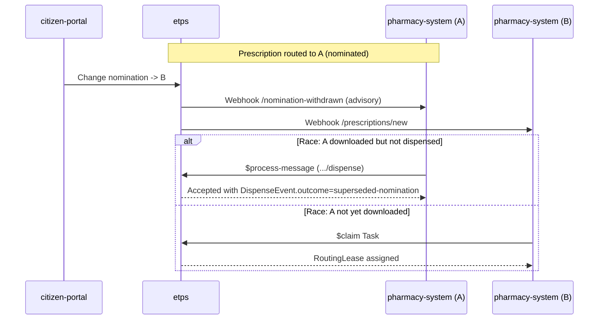
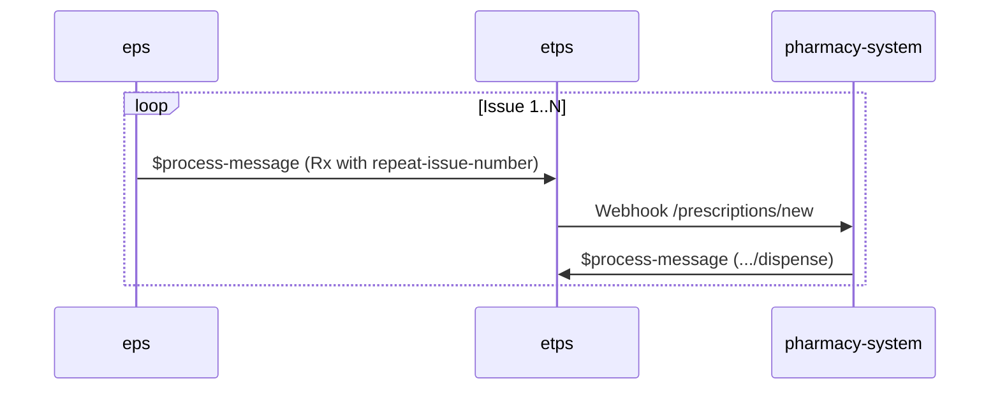

# Workflows

Sequence diagrams for the core journeys. These align 1:1 with BulletTrain
journeys J1-J10 authored by the test harness in the consumer simulators.

## J1 — Happy-path prescribe to dispense

```mermaid
sequenceDiagram
    participant Prescriber as provider-portal
    participant EPS as eps (clinical)
    participant ETPS as etps (transport)
    participant Dispenser as pharmacy-system
    participant Patient as citizen-portal

    Prescriber->>EPS: Compose + CDS review
    EPS-->>Prescriber: Hard-stops resolved; sign
    Prescriber->>ETPS: $process-message (Bundle.type=message, eventUri=.../prescribe)
    ETPS->>ETPS: Verify JWS, validate profile, persist, audit
    ETPS-->>Prescriber: Bundle.type=message-response (accepted)
    ETPS->>Dispenser: Webhook /prescriptions/new (HMAC-signed)
    Dispenser->>EPS: Clinical review, intervention log
    Dispenser->>ETPS: $process-message (.../dispense)
    ETPS->>ETPS: Verify, reconcile state, audit
    ETPS-->>Prescriber: Webhook /dispense (HMAC-signed)
    Patient->>ETPS: GET /prescription-tracker (scope: patient)
    ETPS-->>Patient: EpsTrackerQueryBundle
```

## J2 — Nomination churn mid-flow



## J3 — Repeat dispensing (eRD)

Parent prescription authorises N issues over interval_days. EPS owns the
`repeat-issue-number` extension and releases each issue on schedule.



## J4 — Schedule 2 controlled drug

Enhanced audit; two-factor re-auth on dispense; positive-ack required.
Controlled-drug register append is a separate webhook fan-out.

## J5 — Spine outage: store-and-forward

```mermaid
sequenceDiagram
    participant Pharm as pharmacy-system (offline)
    participant LocalQ as local queue
    participant ETPS as etps (down)

    Note over ETPS: Transport outage
    Pharm->>LocalQ: Dispense event with idempotency-key=D1
    Note over LocalQ: Queue holds 5 events; ETPS unreachable
    Note over ETPS: Recovery
    LocalQ->>ETPS: Replay all 5 events
    ETPS->>ETPS: Dedupe by idempotency-key; reconcile exactly once
    ETPS-->>LocalQ: ACK per event
```

## J6 — Duplicate paracetamol hard-stop

Reproduces the QE Hospital paracetamol coroner PFD 2025 scenario as a
synthetic positive test vector. `ExampleRxParacetamolOne` + `ExampleRxParacetamolTwo`
fire the `duplicate-therapy-ingredient` hard-stop at prescribe time.

## J7 — Penicillin / penicillamine allergy disambiguation

Patient has `allergen-group = penicillin-class` recorded. Prescription of
penicillamine (which is NOT in penicillin class) MUST NOT trigger an
allergy hard-stop. Prescription of any penicillin-class drug MUST trigger
a hard-stop.

## J8 — Paediatric 10x dose hard-limit block

Patient age 5y, weight 18.5 kg. Prescribed anticoagulant at 10x the
expected per-kg dose. EPS's `paediatric-dose-band` rule computes the dose
per-kg, finds it exceeds `hardLimitPerKg`, fires `hard-stop`, blocks
sign-and-send.

## J9 — Cross-border (EU Directive 2011/24)

Non-UK prescriber issues prescription; UK dispenser fulfils. ETPS routes
based on `OrganizationNPI`/`Organization`.identifier regardless of
jurisdiction; EPS terminology binding covers both SNOMED CT-International
and dm+d.

## J10 — LMIC intermittent connectivity

Same as J5 but with higher event volume and longer outage window, plus
the idempotent-dispense assertion repeated across a 24h reconnection.
